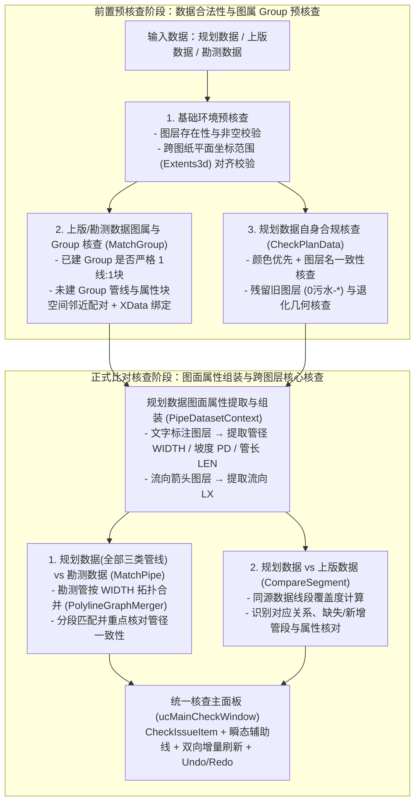

# 管线核查业务需求与测试数据解析报告

## 一、 业务背景与三套数据定位

管线核查工作流围绕 **规划数据**、**上版数据** 与 **勘测数据** 三套数据展开。所有核查规则统一接入 [`ICheckRule`](../Core/ICheckRule.cs) 框架与主核查窗口 [`ucMainCheckWindow`](../Forms/ucMainCheckWindow.xaml.cs)：

1. **规划数据（[`Data/新版数据.dwg`](../Data/新版数据.dwg)）**：本轮核查与维护的核心对象，包含规划新建管、现状管、规划改扩建管三类管线，以及图面流向箭头、管径/规格文字标注、检查井标高标注等附属图元。
2. **上版数据（[`Data/上版数据.dwg`](../Data/上版数据.dwg)）**：上一轮已核查提交的成果数据，由管线图形图层与 `ws` 属性块图层两部分组成，原则上通过 CAD `Group` 绑定图属关系。在核查过程中，上版数据向规划数据提供同源比对与属性核查依据，且**支持在核查过程中进行编辑修正（包括图形修改、属性修改与 Group 绑定维护）**。
3. **勘测数据（[`Data/勘测管.dwg`](../Data/勘测管.dwg)）**：实测现状管网数据，由管线图形与 `1` 属性块（含管径 `WIDTH` 与高度 `HEITH`）组成，用于向规划数据的全部三类管线提供空间匹配与管径一致性校核依据，在管线核查过程中作为**只读基准数据**使用。

---

## 二、 测试样例数据实测解析与业务规则字典

三份样例数据的平面坐标范围完全吻合（均位于 `X: 131438 ~ 144043, Y: 19138 ~ 26895` 范围内，同一坐标系），各数据集的图层、颜色、属性及编组（Group）实测结果如下：

### 1. 规划数据（[`Data/新版数据.dwg`](../Data/新版数据.dwg)）解析

#### (1) 颜色优先 + 图层名双重校验规则
- **判定原则**：**颜色优先级高于图层名**；若管线图元实际颜色（`ByLayer` 取图层颜色，显式赋色取图元颜色）与所属图层名对应的业务类别不一致，或存在非标准图层/退化几何，均列入待核查数据项交由人工判断。

| 管线业务类别 | 标准颜色定义（最高优先级） | 标准图层名列表 | `新版数据.dwg` 实测正常图元数 | `新版数据.dwg` 实测异常图元（列入待核查项） |
| :--- | :--- | :--- | :---: | :--- |
| **规划新建管** | 红色 (`RGB: 255,0,0` / `ACI=1`) | `3-污水管-2025新建` `3-污水压力管-规划新建` | 10 条（含 1 条圆弧 `Bulge`） 3 条（含 1 条圆弧 `Bulge`） | 无 |
| **现状管** | 蓝色 (`RGB: 0,0,255` / `ACI=5`) | `3-污水管-现状` `3-污水压力管-现状` | 222 条 5 条 | - **4 条绿色 (`ACI=3`) 管线**（位于 `3-污水管-现状`，Handle: `139, 213, 241, 242`）：颜色与图层名不一致 - **1 条长度为 0 的退化闭合线**（Handle: `184`） |
| **规划改扩建管** | 洋红色 (`RGB: 255,0,255` / `ACI=6`) | `3-污水管-规划扩建` | 15 条 | 无 |
| **残留旧版图元** | 图元颜色分别为 `ACI=1 / 5 / 6` | `0污水-已核实需新增` (线) `0污水-属性` (块) | 0 条 | - `0污水-已核实需新增` 的 **3 条多段线**（Handle: `10D, 10F, 1A3`） - `0污水-属性` 的 **3 个 `ws` 属性块**（Handle: `4EA, 517, 52C`） |

#### (2) 规划数据中的配套标注图层（实测汇总）
规划数据中 `GroupDictionary.Count = 0`，管线的流向、管径、标高信息以独立图元形式分布在以下图层，需通过通用空间邻近配对算法提取：
- **流向箭头**：`污水-流向`（**229** 个 `jt-fy` 块）、`3-标注-流向`（0 个）。
- **管径/规格文字（`DBText`）**：
  - `2-管线规格-现状`（**194** 个单行文字，样例：`d400`、`d600`、`d800-i1.0`）
  - `2-管线名称-2025`（**14** 个单行文字，样例：`d600-i5.6-L1080`、`DN600-L2216`、`d800-i2.3-L350`）
  - `3-标注-管线标注-规划扩建`（**8** 个单行文字，样例：`d700-i2.0-L900`、`d1000-i2.0-L310`）
- **检查井与标高标注**：`污水-标高标注`（**204** 个 `污水检查井` 块）、`3-标注-检查井`（**35** 个 `MText` 如 `17.99 14.69` + **72** 条引线）。

---

### 2. 上版数据（[`Data/上版数据.dwg`](../Data/上版数据.dwg)）与勘测数据（[`Data/勘测管.dwg`](../Data/勘测管.dwg)）解析

#### (1) 两份参考数据的结构与实测对比
| 维度 | 上版数据（[`Data/上版数据.dwg`](../Data/上版数据.dwg)） | 勘测数据（[`Data/勘测管.dwg`](../Data/勘测管.dwg)） |
| :--- | :--- | :--- |
| **读写属性** | **核查过程中可编辑（Mutable）** | **只读基准数据（Read-Only）** |
| **图形图层与数量** | 共 **317** 条 `Polyline`： - `0污水-待补测现状管` (151) - `0污水-规划新建` (148) - `0污水-规划改建` (15) - `0污水-已核实需新增` (3) | 共 **5,823** 条 `Polyline`： - `勘测管` (5,823) *(图形较短碎，不限于 `degree > 2` 处打断)* |
| **属性图层与块名** | `0污水-属性` 图层，共 **317** 个 `ws` 块 | `勘测管` 图层，共 **5,823** 个 `1` 块 |
| **属性字段 (Tag)** | 共 **19** 个字段： 核心 16 项：`QSBG, MDBG, QSMS, MDMS, PD, LEN, TYPE, GHZT, WIDTH, HEITH, YWIDTH, YHEITH, LX, SJLY, BZRQ, BZH` 额外 3 项：`QSDM, MDDM, SHAPE_TYPE` | 共 **2** 个字段： - `WIDTH`：管径/宽度（如 `300, 500, 800, 3000`） - `HEITH`：5,695 条圆管为 `'0'`，128 条渠箱为非零高度（如 `'3000', '2100'`） |
| **实测 Group 状态** | **`GroupDictionary.Count = 0`**（全部未绑定 Group） | **`GroupDictionary.Count = 5823`**（全部已 1:1 绑定 Group） |
| **属性块位置特征** | - 314 个 GIS 导出块的 `Position` **100% 精确位于对应多段线外包框中心 (`GeometricExtents` Center)**：   - 直管段（113 条）：块就在管线上（距曲线 `<= 0.01m`）   - 微弯管段（106 条）：距曲线 `0.01m ~ 5.0m`   - 大弯折管段（95 条）：因外包框中心悬空在折线内侧，距曲线 `5.0m ~ 159.7m` - 3 个人工新增块：距管线 `4.2m ~ 8.9m` | 5,823 个块的 `Position` 全部紧贴在多段线本体上（距曲线最大仅 `0.033m`） |

#### (2) 上版数据 `0污水-属性`（`ws` 块）19 项字段实测明细
| 字段分类 | 属性 Tag (英文缩写) | 业务含义 | 实测值分布 / 样例 |
| :--- | :--- | :--- | :--- |
| **管径与断面** | `WIDTH` / `HEITH` | 管径(宽度) / 高度 | `WIDTH`: `200, 300, 400, 500, 600, 700, 800, 1000, 1200, 1350, 1500`；`HEITH`: 全为 `0` |
| **改扩建原规格** | `YWIDTH` / `YHEITH` | 原管径(宽度) / 原高度 | `YWIDTH`: `0, 200, 300, 400, 500, 600`；`YHEITH`: 全为 `0` |
| **类型与状态** | `TYPE` / `GHZT` | 管线类型 / 规划状态 | `TYPE`: `污水管渠`, `污水压力管`；`GHZT`: `待补测现状管`, `规划新建`, `规划改建` |
| **标高与埋深** | `QSBG` / `MDBG` / `QSMS` / `MDMS` | 起终点标高 / 起终点埋深 | 如 `QSBG='1.35', MDBG='1.21', QSMS='2.550000', MDMS='2.630000'` |
| **地面标高(额外)** | `QSDM` / `MDDM` | 起始地面 / 终点地面标高 | 如 `QSDM='3.9', MDDM='3.84'` |
| **水力与几何** | `PD` / `LEN` / `LX` | 坡度 / 管线长度 / 流向 | `PD`: `0.002~0.05`；`LEN`: 管长(米)；`LX`: `自北向南`, `自东向西`, `自南向北`, `自西向东`, `2` |
| **元数据** | `SJLY` / `BZRQ` / `BZH` / `SHAPE_TYPE` | 来源 / 编制日期 / 备注 / 几何类型 | `SJLY`: 各片区法定图则/专项规划修编；`BZRQ`: `2006~2019`；`BZH`: `0`；`SHAPE_TYPE`: `LINE` |

---

### 3. 核心核查规则矩阵

| 核查模块 | 参与数据集 | 核心算法组件 | 业务核查重点 |
| :--- | :--- | :--- | :--- |
| **1. 参考数据图属与 Group 核查** | `上版数据` 或 `勘测数据` | `PipeSpatialMatcher` + `MatchGroupService` | 1. 检查已存在的 Group 是否严格为 `1 条管线 + 1 个属性块` 2. 对未建 Group 的管线与属性块，融合“曲线最短距离”与“外包框中心距离 + `LEN` 管长校验”进行配对 3. 1:1 唯一匹配支持一键绑定 Group + `XData`；一对多歧义、无匹配或孤立块列入核查面板并绘制辅助线 |
| **2. 规划数据内部核查** | `规划数据` 自身 | `PlanDataSelfCheckService` + [`FlowArrowService`](../Commands/FlowArrow.cs) | 1. 颜色（红/蓝/洋红）与图层名不一致报错（如 4 条绿色现状管） 2. 残留旧图层（`0污水-已核实需新增`、`0污水-属性`）及零长度退化线列入待核查 3. 管线与流向箭头匹配及方向一致性核查，提取流向属性 `LX` 4. 管线与文字标注匹配，提取管径 `WIDTH`、坡度 `PD`、管长 `LEN` |
| **3. 规划数据 vs 勘测数据** | `规划数据`（**全部三类管线**：新建、现状、改扩建） vs `勘测数据`（只读基准） | [`PolylineGraphMerger`](../Geometry/PolylineGraphMerger.cs) + [`MatchPipeService`](../Commands/MatchPipe.cs) | 1. **前置拓扑重建**：针对短碎勘测管，先按端点容差与 `WIDTH` 属性做 Merge 合并，恢复连续长管线并静态缓存 `STRtree` 2. **全类别分段匹配**：用 `MatchPipe` 将规划数据全部三类管线与合并后的勘测管进行分段匹配 3. **管径核对**：重点核查规划管线从图面文字提取的管径与匹配勘测管 `WIDTH` 是否一致 |
| **4. 规划数据 vs 上版数据** | `规划数据` vs `上版数据`（可编辑参考） | [`CompareSegmentService`](../Commands/CompareSegment.cs) | 1. **同源覆盖度匹配**：利用两套数据的同源性，通过 `CompareSegment` 计算线段覆盖比例与缺失/新增区间 2. **对应关系与属性核对**：建立规划管线与上版管线的对应关系，核对管径、流向、规划状态等属性，并支持核查过程中编辑上版数据时的动态增量刷新 |
