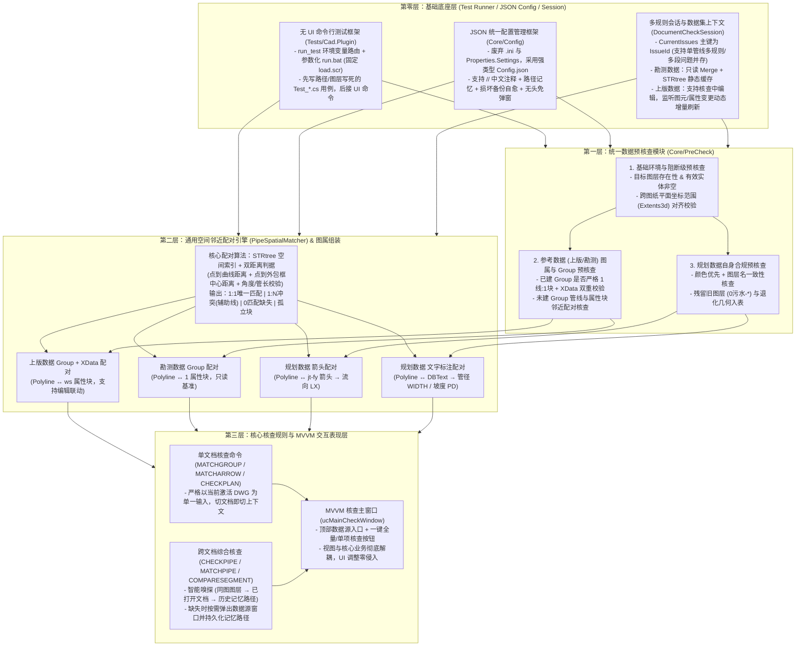

# 管线核查开发计划

## 一、 总体目标与系统架构

本计划面向 CAD 管线核查插件（`process_pipeline`）的完整业务闭环建设。系统以**规划数据**为核心核查与维护对象，以**上版数据**（核查过程中可编辑）和**勘测数据**（只读基准）作为参考依据，构建一套涵盖**无 UI 命令行自动化测试、JSON 统一配置管理、数据预核查、通用空间邻近图属配对、跨图层管线比对核查、以及 MVVM 解耦交互界面**的完整技术体系。

### 1. 四层技术架构

1. **基础底座层（无 UI 命令行测试框架 + JSON 统一配置管理框架 + 多规则会话上下文）**
   - **无 UI 命令行测试框架（`Tests/Cad.Plugin`）**：通过 `run_test` 环境变量路由命令固定 `load.scr`，配合支持命令行传参与交互菜单的 `run.bat`，实现任意测试命令的一键无头执行（`accoreconsole.exe`）与 Visual Studio `F5` 断点调试无缝切换。所有新增核心算法与核查规则均遵循**“先编写无 UI、路径与图层写死的 `Test_*.cs` 命令行测试用例完成验证，再接入正式命令与 UI 面板”**的开发规范。
   - **JSON 统一配置管理框架（`Core/Config`）**：与 `UndoRedoManager`、`ucMainCheckWindow` 平级。废弃原有的 `.ini` 配置文件与 `.NET Properties.Settings`（`app.config`），采用基于 `Newtonsoft.Json`（支持 `//` 中文注释）的强类型分层配置文件 `Config.json`（保留 `CadConfig` 静态访问门面），统一管理全系统的图层名称、颜色映射、任务名称、算法阈值以及最近使用的数据源路径记录，内置“缺失自动生成带注释默认配置、新增字段自动补齐、损坏自动备份并自愈重置、无头测试模式免模态弹窗阻塞”机制。
   - **多规则会话与数据集上下文（`DocumentCheckSession` & `PipeDatasetContext`）**：按 `IssueId`（`{RuleId}:{TargetHandle}:{SubIndex}`）作为问题字典主键，支持同一管线在多规则或多分段下的核查问题并存；统一缓存组装好完整属性的管线模型，并对**只读勘测数据**与**可编辑上版数据**实施差异化缓存与增量刷新策略。
2. **统一数据预核查层（`Core/PreCheck`）**
   - 在执行核心核查算法前，统一校验目标图层存在性、有效实体非空、跨图纸平面坐标范围（`Extents3d`）对齐度、规划数据颜色与图层名一致性、残留图层及参考数据图属 Group 绑定合法性。
   - **阻断级问题（`Blocking`）**通过弹窗直接提示，**待核查级问题（`Reviewable`）**转化为标准 [`CheckIssueItem`](../Models/CheckIssueItem.cs) 汇入主核查窗口供人工判读。
3. **通用空间邻近配对与图属组装层（`PipeSpatialMatcher`）**
   - 针对 CAD 图元缺乏原生 GIS 属性绑定的特点，抽象统一的“管线-邻近附属图元”空间匹配引擎，统一支撑：
     - 上版数据管线（`Polyline`）$\leftrightarrow$ `ws` 属性块（`BlockReference`）的 Group + `XData` 配对；
     - 勘测数据管线（`Polyline`）$\leftrightarrow$ `1` 属性块（`BlockReference`）的 Group + `XData` 配对；
     - 规划数据管线（`Polyline`）$\leftrightarrow$ 流向箭头块（`jt-fy`）的空间配对与流向（`LX`）提取；
     - 规划数据管线（`Polyline`）$\leftrightarrow$ 图面文字标注（`DBText` / `MText`）的空间配对与管径（`WIDTH`）、坡度（`PD`）、管长（`LEN`）提取。
4. **跨图层核心核查与 MVVM 交互表现层（`ICheckRule` & `Forms`）**
   - **规划数据 vs 勘测数据（`MatchPipeService`）**：对短碎勘测管按 `WIDTH` 执行拓扑合并（`PolylineGraphMerger.Merge`），将规划数据全部三类管线（新建、现状、改扩建）与合并后的勘测管进行分段匹配（`PipeMatcher`），重点核查管径一致性。
   - **规划数据 vs 上版数据（`CompareSegmentService`）**：利用同源线段覆盖度算法（`CompareCoverage`）识别规划数据与上版数据的对应关系、新增/缺失管段，并核对 19 项业务属性的一致性与继承关系。
   - **MVVM 视图与核心业务解耦**：所有数据源嗅探/绑定、核查命令调度与结果过滤均封装在独立的服务层与 ViewModel 中，WPF 界面（`ucMainCheckWindow` 工具栏、数据源设置弹窗）仅做数据绑定与命令触发，确保后续界面样式调整或交互重构不影响底层核心逻辑。

---

## 二、 核心业务规则与数据规范

### 1. 规划数据（[`Data/新版数据.dwg`](../Data/新版数据.dwg)）核查与属性提取规范

#### (1) 颜色优先 + 图层名双重校验规则
- **判定原则**：**颜色优先级高于图层名**；当管线图元实际颜色与所属图层名对应的业务类别不一致，或存在残留旧图层、退化几何时，统一列入待核查数据项交由人工判断。

| 管线业务类别 | 标准颜色定义（最高优先级） | 标准图层名列表 | 样例数据正常图元数 | 样例数据预核查异常项（需报错入表） |
| :--- | :--- | :--- | :---: | :--- |
| **规划新建管** | 红色 (`RGB: 255,0,0` / `ACI=1`) | `3-污水管-2025新建` `3-污水压力管-规划新建` | 10 条 3 条 | 无 |
| **现状管** | 蓝色 (`RGB: 0,0,255` / `ACI=5`) | `3-污水管-现状` `3-污水压力管-现状` | 222 条 5 条 | - **4 条绿色 (`ACI=3`) 管线**（位于 `3-污水管-现状`，Handle: `139, 213, 241, 242`）：颜色与图层不一致 - **1 条长度为 0 的退化闭合线**（Handle: `184`） |
| **规划改扩建管** | 洋红色 (`RGB: 255,0,255` / `ACI=6`) | `3-污水管-规划扩建` | 15 条 | 无 |
| **残留旧版图元** | 图元颜色为 `ACI=1 / 5 / 6` | `0污水-已核实需新增` (线) `0污水-属性` (块) | 0 条 | - `0污水-已核实需新增` 的 **3 条多段线**（Handle: `10D, 10F, 1A3`） - `0污水-属性` 的 **3 个 `ws` 属性块**（Handle: `4EA, 517, 52C`） |

#### (2) 规划数据图面属性提取规则
- **管径（`WIDTH`）/ 坡度（`PD`）/ 管长（`LEN`）**：从文字标注图层 `2-管线规格-现状`（如 `d400`、`d800-i1.0`）、`2-管线名称-2025`（如 `d600-i5.6-L1080`、`DN600-L2216`）、`3-标注-管线标注-规划扩建`（如 `d700-i2.0-L900`）按空间邻近与走向平行关系匹配解析。
- **流向（`LX`）**：从流向箭头图层 `污水-流向`（`jt-fy` 块）、`3-标注-流向` 按空间邻近与角度关系匹配提取。

---

### 2. 上版数据（[`Data/上版数据.dwg`](../Data/上版数据.dwg)）与勘测数据（[`Data/勘测管.dwg`](../Data/勘测管.dwg)）规范

| 维度 | 上版数据（[`Data/上版数据.dwg`](../Data/上版数据.dwg)） | 勘测数据（[`Data/勘测管.dwg`](../Data/勘测管.dwg)） |
| :--- | :--- | :--- |
| **读写属性** | **核查过程中可编辑（Mutable）**：支持修改图形、修改 `ws` 块属性、绑定/调整 Group，缓存支持事件驱动局部更新与联动增量核查 | **只读基准数据（Read-Only）**：不做核查与修改，Merge 后的拓扑与 `STRtree` 空间索引在会话中静态缓存 |
| **图形图层与数量** | 共 **317** 条 `Polyline`： - `0污水-待补测现状管` (151) - `0污水-规划新建` (148) - `0污水-规划改建` (15) - `0污水-已核实需新增` (3) | 共 **5,823** 条 `Polyline`： - `勘测管` (5,823) *(图形较短碎，不限于 `degree > 2` 处打断)* |
| **属性图层与块名** | `0污水-属性` 图层，共 **317** 个 `ws` 块 | `勘测管` 图层，共 **5,823** 个 `1` 块 |
| **属性字段 (Tag)** | 共 **19** 个字段： 核心 16 项：`QSBG, MDBG, QSMS, MDMS, PD, LEN, TYPE, GHZT, WIDTH, HEITH, YWIDTH, YHEITH, LX, SJLY, BZRQ, BZH` 额外 3 项：`QSDM, MDDM, SHAPE_TYPE` | 共 **2** 个字段： - `WIDTH`：管径/宽度（如 `300, 500, 800, 3000`） - `HEITH`：5,695 条圆管为 `'0'`，128 条渠箱为非零高度（如 `'3000', '2100'`） |
| **样例 Group 状态** | **`GroupDictionary.Count = 0`**（全部未绑定 Group） | **`GroupDictionary.Count = 5823`**（全部已 1:1 绑定 Group） |
| **属性块位置特征与匹配策略** | 314 个 GIS 导出块的 `Position` 精确位于对应多段线外包框中心 (`GeometricExtents` Center)，其中 95 条大弯折管线的外包框中心距曲线 `5m ~ 159.7m`。 **匹配策略**：融合“点到曲线距离”与“点到外包框中心距离 + `LEN` 管长校验”。 | 5,823 个块的 `Position` 全部紧贴在多段线本体上（距曲线最大仅 `0.033m`）。 |

---

## 三、 关键技术机制与交互架构设计

### 1. 单文档命令与多数据源命令的交互及 MVVM 解耦设计
- **单文档核查命令模式（`MATCHGROUP` / `MATCHARROW` / `CHECKPLAN`）**：
  - 严格以当前激活的 DWG 文档（`MdiActiveDocument`）作为唯一输入数据源，只核查当前文档。
  - 在多文档（MDI）环境下，用户在 CAD 中切换文档标签页即自动切换对应的 `DocumentCheckSession` 上下文，无需额外设置数据源。
- **多数据源综合核查模式（`CHECKPIPE` / `MATCHPIPE` / `COMPARESEGMENT`）**：
  - **当前激活文档默认作为【规划数据】**；对于参考数据（【上版数据】与【勘测数据】），系统通过独立的 `DataSourceResolver` 服务按优先级自动嗅探：
    1. **同图多图层探测**：若当前 DWG 内已包含上版图层（`0污水-*`）或勘测图层（`勘测管`）且存在有效实体，直接采用当前图内部图层；
    2. **MDI 已打开文档探测**：遍历当前 CAD 已打开的其他文档标签页，若某文档包含目标上版/勘测图层，自动关联该已打开文档（便于边核查边在另一标签页编辑上版数据并实时内存联动）；
    3. **历史记忆与同目录探测**：读取 `Config.json` 中持久化保存的上次设置路径（`LastPreviousDataPath` / `LastSurveyDataPath`）或同级目录同名文件。
  - **按需弹窗与路径持久化记忆**：仅当自动嗅探未能确定有效数据源（或用户主动点击面板上的 `[数据源设置]` 按钮）时，弹出数据源配置窗口；窗口默认回填上次保存的路径配置，用户确认后自动写回配置持久化保存，避免每次重复设置。
- **MVVM 视图与核心逻辑彻底解耦**：
  - 数据源绑定模型（`DataSourceBindingConfig`）、嗅探与校验逻辑（`DataSourceService`）、核查调度器（`CheckPipelineCoordinator`）完全独立于 WPF 控件，通过 `DataSourceSettingsViewModel` 与 `MainCheckWindowViewModel` 暴露属性和 `ICommand`。
  - 主核查窗口 [`ucMainCheckWindow`](../Forms/ucMainCheckWindow.xaml) 顶部工具栏提供 `[数据源]`、`[一键全量核查]`、`[单项核查]` 按钮，同时完整保留所有 CAD 命令行入口。后续若需调整 UI 布局或交互细节，仅需修改 XAML 视图层，底层核心功能零改动。

### 2. 会话多问题主键机制（`IssueId` 索引）
- **设计目标**：解决以单一管线 `ObjectId` 作为字典 Key 导致“同一根管线在多规则下问题互相覆盖”、“单根长管线跨越多个勘测管段产生多段管径不符子问题无法共存”以及“跨图缺失管段 `TargetObjectId == ObjectId.Null` 键冲突”的问题。
- **实现方式**：
  - [`DocumentCheckSession`](../Core/DocumentCheckSession.cs) 内部以 `IssueId`（`{RuleId}:{TargetHandle}:{SubIndex}`）作为问题主存储键，同时维护 `TargetObjectId -> List<string>(IssueIds)` 反向索引。
  - 将 `DocumentCheckSession.ActiveRule` 升级为 `ActiveRules` 字典集合，支持同一文档会话中多条核查规则结果并存与联动增量重算。

### 3. 管线图属组装上下文（`PipeDatasetContext`）
- **设计目标**：避免 `MatchPipe`、`CompareSegment` 等多个核查规则各自重复扫描文字图层、箭头图层与 Group 字典，确保全系统属性口径一致。
- **实现方式**：
  - 在 `DocumentCheckSession` 中维护 `PipeDatasetContext`，将预核查与空间配对阶段提取出的规划管线【业务类别（由颜色+图层判定）、管径 `WIDTH` / 坡度 `PD`（由文字标注提取）、流向 `LX`（由流向箭头提取）】统一挂载到 [`CadPolyline.Attributes`](../Models/CadPolyline.cs) 中。

### 4. 差异化参考数据缓存：**勘测数据只读静态缓存 vs 上版数据可编辑动态感知**
- **勘测数据（只读静态缓存 `Immutable Survey Cache`）**：
  - 首次加载勘测管并按 `WIDTH` 完成 [`PolylineGraphMerger.Merge()`](../Geometry/PolylineGraphMerger.cs) 后，将合并后的 `List<CadPolyline>` 与构建好的 `STRtree<CadPolyline>` 空间索引常驻 `PipeDatasetContext`（仅记录外部文件时间戳指纹，立即关闭 `SideDatabase` 释放文件锁）。
  - 规划管线修改触发 `CheckIncremental` 时，直接查询内存中的勘测管 `STRtree`，实现毫秒级局部比对。
- **上版数据（可编辑动态感知缓存 `Mutable & Event-Aware Previous Data Cache`）**：
  - 数据库监听层与 [`ICheckRule.GetAffectedTargetIds`](../Core/ICheckRule.cs) **同时监听规划数据图层（`3-污水管-*`）与上版数据图层（`0污水-*` 图形层及 `0污水-属性` 块图层）的增删改事件**（含多段线顶点编辑、`ws` 属性块位移、块内 `AttributeReference` 字段值修改、Group 绑定变更）。
  - 当检测到某条上版数据管线或 `ws` 属性块被编辑时，立即在 `PipeDatasetContext` 中局部更新该条上版管线的几何与 19 项属性字典，并通过空间索引反查出其影响范围内的规划管线 `ObjectId`，自动触发 `CheckIncremental` 局部刷新核查面板。
  - 若上版数据通过外部 `SideDatabase` 读取，则同时校验文件修改时间戳（`LastWriteTimeUtc`），发生外部保存时自动触发重载。

### 5. 基于 JSON 的强类型分层配置管理（`Core/Config`）
- **设计目标**：废弃在 AutoCAD 插件宿主下外部修改无效的 `.NET Properties.Settings`（`app.config`）以及原有的扁平 `.ini` 格式，采用主流的 `.json` 格式统一管理二维层级配置（如三类规划管的颜色+图层列表+文字图层映射、算法参数块、最近数据源路径记忆）。
- **实现方式**：
  - 基于 `Newtonsoft.Json`（开启 `CommentHandling.Ignore`）实现支持 `//` 中文注释的 `Config.json` 与强类型分层配置类 `AppConfig`，保留 `CadConfig` 静态属性作为向下兼容门面。
  - 完整实现“文件不存在时自动生成带中文注释的标准 `Config.json`、版本升级新增字段自动补齐、格式损坏自动备份为 `Config_error_bak.json` 并自愈重置”机制。
  - 自动识别运行环境：在交互式 CAD 下异常时弹窗提示，在 `accoreconsole.exe` 无头测试环境下自动转为控制台与日志输出，不阻塞自动化测试进程。

### 6. CAD `Group` + `XData` 双重图属持久化
- **设计目标**：防止 CAD 原生 `GroupDictionary` 在跨图复制粘贴（`Ctrl+C/V`）、写块（`WBLOCK`）或导出时丢失。
- **实现方式**：
  - 在 `MatchGroup` 命令创建或修复 CAD `Group` 时，同步在管线 `Polyline` 与属性块 `BlockReference` 的 `XData`（注册应用名 `PIPE_CHECK_LINK`）中写入配对句柄。
  - [`GeometryHelper`](../Geometry/GeometryHelper.cs) 读取图属关系时，按 **`GroupDictionary` $\rightarrow$ `XData` 配对句柄 $\rightarrow$ `PipeSpatialMatcher` 空间距离兜底** 的三级优先级自动提取属性。

---

## 四、 分阶段开发计划与 Commit 路线图

> [!NOTE]
> 以下阶段与 Commit 编号（`1.1`、`2.1` 等）作为开发主线的结构性里程碑；在实际迭代与测试过程中，可根据需要随时穿插 UI 样式调整、交互优化或缺陷修复等独立 Commit。所有新算法与核查功能均遵循**“先编写无 UI、路径与图层写死的 `Test_*.cs` 命令行测试用例，验证通过后再接入正式命令与 MVVM 界面”**的流程。

### 阶段一：无 UI 命令行测试框架改造（`Tests/Cad.Plugin`）
> **阶段目标**：消除每次切换测试命令都需手动修改 [`load.scr`](../Tests/Cad.Plugin/load.scr) 的痛点，支持命令行直接传参运行与交互式菜单选择，同时保持 Visual Studio `F5` 断点调试体验。

- **Commit 1.1：改造 `Tests/Cad.Plugin` 测试路由入口与 `run.bat` 命令行运行脚本**
  - 在 [`Tests/Cad.Plugin/TestPluginEntry.cs`](../Tests/Cad.Plugin/TestPluginEntry.cs) 中新增统一测试路由命令 `[CommandMethod("run_test")]`，读取环境变量 `CAD_TEST_CMD` 自动分发执行对应测试类（无环境变量时执行默认调试命令）。
  - 将 [`Tests/Cad.Plugin/load.scr`](../Tests/Cad.Plugin/load.scr) 的执行命令固定为 `run_test`。
  - 升级 [`Tests/Cad.Plugin/run.bat`](../Tests/Cad.Plugin/run.bat)：默认底图改为项目内的 `Data\新版数据.dwg`，支持带参数直接执行（如 `run.bat test_match_pipe`）以及无参数时的编号菜单交互选择。

---

### 阶段二：JSON 统一配置管理框架（`Core/Config`）与会话多问题模型加固
> **阶段目标**：构建基于 `Config.json` 的强类型分层配置模块 `Core/Config`，取代原有的 `Properties.Settings` 与 `.ini` 配置；升级 `DocumentCheckSession` 支持单管线多问题并存、差异化数据集缓存与数据源嗅探服务。

- **Commit 2.1：实现基于 `Config.json` 的统一配置管理框架 `Core/Config` 并迁移现有调用**
  - 在 `Core/Config` 下实现 `AppConfig` 与 `ConfigManager`，采用 `Newtonsoft.Json`（支持 `//` 中文注释）管理分层配置：规划三类管线（颜色 `ACI/RGB`、管线图层、文字标注图层）、流向箭头图层、上版图形与属性图层、勘测管图层、任务名称、算法参数块以及最近使用的数据源路径（`DataSourceSettings`）。
  - 保留 `CadConfig` 静态兼容属性，替换项目中所有 `Properties.Settings.Default.task*` 调用，移除旧 `.ini` 解析代码。
- **Commit 2.2：编写配置管理框架无 UI 测试用例 `Tests/Cad.Plugin/Test_Config.cs`**
  - 新增 `[CommandMethod("test_config")]`，在命令行下无 UI 自动化验证默认带注释 `Config.json` 生成、自定义参数读取、路径持久化保存、损坏文件自愈备份及 `Reload()` 热重载。
- **Commit 2.3：升级 `DocumentCheckSession` 支持 `IssueId` 多问题并存、实现 `PipeDatasetContext` 与 `DataSourceService`（MVVM 核心服务层）**
  - 升级 `DocumentCheckSession` 的问题存储索引与多规则管理集合 `ActiveRules`，支持同一管线挂载多条不同规则/分段的问题及跨图缺失问题。
  - 实现 `PipeDatasetContext` 与 `DataSourceService`（支持同图图层、MDI 已打开文档、历史记忆路径的三级智能嗅探，区分**勘测数据只读静态缓存**与**上版数据可编辑动态缓存**）。

---

### 阶段三：通用空间邻近配对引擎与“上版数据 / 勘测数据”图属 Group + XData 核查
> **阶段目标**：实现通用空间邻近度匹配器 `PipeSpatialMatcher`，先通过无 UI 测试用例验证上版数据与勘测数据的配对准确率，再落地单文档模式 `MATCHGROUP` 核查命令与 Group + `XData` 可逆绑定操作。

- **Commit 3.1：实现通用管线邻近要素空间匹配器 `PipeSpatialMatcher` 与无 UI 测试用例 `Test_Match_Group.cs`**
  - 在 `Geometry` 层实现 `PipeSpatialMatcher<TAttachment>`，内置 `STRtree` 空间索引与双距离判据（曲线最短距离 `DistToCurve` + 外包框中心距离 `DistToExtentsCenter` + 可选管长 `LEN`/角度校验），输出 `UniqueMatch`（1:1）、`OneToManyConflict`（1:N 含 `PossibleMatches`）、`NoMatchPipe`、`OrphanAttachment`。
  - 在 `Tests/Cad.Plugin` 下新增 `Test_Match_Group.cs`（命令：`test_match_group`），写死读取 `Data\上版数据.dwg` 与 `Data\勘测管.dwg`，无 UI 验证 317 条上版管线（含 95 条大弯折管线）的配对结果与 5,823 个勘测管 Group 的合法性校验。
- **Commit 3.2：实现单文档图属与 Group 核查命令（`MATCHGROUP`）、`XData` 加固及可逆绑定操作**
  - 新增 `Commands/MatchGroup.cs`（`MatchGroupService : ICheckRule`），严格以当前激活 DWG 为单一输入，核查已建 Group 的 1:1 合法性及未建 Group 的空间配对歧义/缺失，在 `ucMainCheckWindow` 中展示结果并绘制一对多瞬态辅助线，支持上版数据在核查过程中编辑后的增量重算。
  - 新增 `BindPipeGroupOperation : IUserOperation`，在创建/修复 CAD `Group` 的同时写入 `XData`（`PIPE_CHECK_LINK` 配对句柄），并接入 `HybridUndoRedoManager` 的 `Undo` / `Redo`。
  - 升级 `GeometryHelper.CollectPolylinesFromLayer(s)`，按 **`GroupDictionary` $\rightarrow$ `XData` $\rightarrow$ `PipeSpatialMatcher`** 三级优先级提取属性挂载至 `CadPolyline.Attributes`。

---

### 阶段四：统一“数据预核查（Pre-Check）”模块与规划数据自身合规核查
> **阶段目标**：构建独立的 `Core/PreCheck` 预核查模块，实现跨图坐标范围校验及单文档模式下的规划数据自身颜色优先级、图层名一致性、残留图层与退化几何核查。

- **Commit 4.1：实现统一数据预核查模块 `Core/PreCheck`、规划自检服务及无 UI 测试用例 `Test_Check_Plan.cs`**
  - 在 `Core/PreCheck` 中实现图层存在性、有效实体非空、跨图纸坐标范围（`Extents3d`）对齐等通用预核查规则，以及规划数据“颜色优先 vs 图层名冲突（检出 4 条绿色现状管 `139, 213, 241, 242`）、残留旧图层（`0污水-已核实需新增`、`0污水-属性`）、零长度退化线（`Handle=184`）”核查逻辑。
  - 在 `Tests/Cad.Plugin` 下新增 `Test_Check_Plan.cs`（命令：`test_check_plan`），写死读取 `Data\新版数据.dwg` 等测试文件，无 UI 验证所有预核查异常项的检出结果。
- **Commit 4.2：接入正式命令 `CHECKPLAN` 与主核查窗体，并迁移 `FlowArrowService` 前置检查**
  - 新增 `Commands/CheckPlanData.cs`（命令：`CHECKPLAN`，针对当前激活文档），将规划数据自检问题项接入 `ucMainCheckWindow` 并支持图元颜色/图层修改后的增量刷新。
  - 将 `FlowArrow.cs` 第 119 行的图层前置检查迁移至 `Core/PreCheck`，并将流向箭头核查提取出的流向属性同步写入 `PipeDatasetContext`。

---

### 阶段五：规划数据图面文字属性（管径/规格）提取与组装缓存
> **阶段目标**：复用 `PipeSpatialMatcher`，从规划数据的文字标注图层中解析并绑定管径（`WIDTH`）、坡度、管长，汇总写入 `PipeDatasetContext`。

- **Commit 5.1：实现规划管线文字标注解析器 `PipeLabelParser` 与无 UI 测试用例 `Test_Match_Text.cs`**
  - 实现 `PipeLabelParser`，正则解析 `2-管线规格-现状`（如 `d400`、`d800-i1.0`）、`2-管线名称-2025`（如 `d600-i5.6-L1080`、`DN600-L2216`）、`3-标注-管线标注-规划扩建`（如 `d700-i2.0-L900`）中的管径 `WIDTH`、坡度 `PD`、管长 `LEN`。
  - 复用 `PipeSpatialMatcher` 完成规划管线与文字标注的空间+平行角度配对，将结果组装至 `PipeDatasetContext`，并编写 `Tests/Cad.Plugin/Test_Match_Text.cs`（命令：`test_match_text`）在 `Data\新版数据.dwg` 上无 UI 验证提取结果与未匹配管线明细。
- **Commit 5.2：将规划管线文字标注配对接入 `MATCHGROUP` 主核查面板连线复核，并识别不规范文字标注列入待核查列表**
  - 增强 `PipeLabelParser`：识别并排多管标注（如 `2DN1000`）与变径范围标注（如 `d600-700`），标记 `HasIrregularFormat = true` 及 `IrregularReason`，在提取主管径 `WIDTH` 的同时写入 `IRREGULAR_LABEL` 供人工复核。
  - 升级 `PipeSpatialMatcher` 规划文字配对链路：支持 **`GroupDictionary` $\rightarrow$ `XData` (`PIPE_CHECK_LINK`) $\rightarrow$ 空间距离+平行角** 三级优先级；自动识别不规范文字标注（`2DN1000`、`d600-700`）、一管多标（单条长干管旁存在多个文字标注）、多段共标/无专属标注管段及长干管多余标注，并为全部配对项与异常项生成 `PossibleMatches` 瞬态辅助连线数据。
  - 升级 `MatchGroupService`（`MATCHGROUP` 命令）与 `ucMainCheckWindow`：自动感知当前图纸类型（规划文字标注图纸 vs 上版/勘测属性块图纸）；将高置信度 1:1 文字配对列为【待复核（`ToRecheck`）】，将不规范标注、一管多标、多段共标/缺标管段及多余标注列为【待核查（`Pending`）】，支持点击绘制红色配对连线、右键一键绑定 CAD `Group` + `XData`（含 `Undo`/`Redo`）及修改文字/管线后的增量重算，并在 `Test_Match_Text.cs` 中补充无 UI 自动化验证。

---

### 阶段六：三方数据跨图核心核查规则接入与 MVVM 多数据源工作台集成
> **阶段目标**：在无 UI 测试用例验证通过的基础上，将 `MatchPipeService` 和 `CompareSegmentService` 全面接入 `ICheckRule`、`PipeDatasetContext`，并以 MVVM 模式完成 `CHECKPIPE` 多数据源配置窗口与主核查面板工具栏集成。

- **Commit 6.1：升级 `Test_Match_Pipe.cs` 验证三类规划管与只读合并勘测管的管径核查，并完善 `MatchPipeService : ICheckRule`**
  - 升级 `Tests/Cad.Plugin/Test_Match_Pipe.cs`（命令：`test_match_pipe`）：串联 `PipeDatasetContext` 中的规划管文字管径与只读勘测管（按 `WIDTH` 拓扑合并 + 静态 `STRtree` 缓存），对**全部三类规划管线（新建、现状、改扩建）**执行 `PipeMatcher` 并核对管径一致性，在命令行输出完整核查报表。
  - 完善 `MatchPipeService : ICheckRule`，支持分段管径不符的多子项（`SubIndex`）问题输出与规划管线修改时的毫秒级增量重算。
- **Commit 6.2：升级 `Test_Compare_Segment.cs` 验证规划与可编辑上版数据同源覆盖及属性核查，并完善 `CompareSegmentService : ICheckRule`**
  - 升级 `Tests/Cad.Plugin/Test_Compare_Segment.cs`（命令：`test_compare_segment`）：写死读取 `Data\上版数据.dwg` 与 `Data\新版数据.dwg`，验证同源覆盖关系与 19 项属性对比。
  - 完善 `CompareSegmentService : ICheckRule`：实现**双向编辑增量感知**——无论用户在核查过程中修改了规划数据管线，还是编辑了上版数据的图形、`ws` 属性块或 Group 绑定，均自动更新 `PipeDatasetContext` 并局部刷新受影响管段的比对核查结果。
- **Commit 6.3：基于 MVVM 模式实现多数据源配置视图与 `ucMainCheckWindow` 工具栏核查调度集成**
  - 实现 `DataSourceSettingsViewModel` 与数据源配置窗口（支持同图图层、MDI 已打开文档、外部 DWG 文件下拉选择与浏览，并与 `Config.json` 双向绑定记忆上次路径）。
  - 在 `CHECKPIPE` 命令及 `ucMainCheckWindow` 顶部工具栏集成 `[数据源]`、`[一键全量核查]`、`[单项核查]` 绑定命令：执行跨图核查时先走 `DataSourceService` 智能嗅探，无法确定时自动弹出数据源设置窗口，实现 UI 表现层与底层核查业务的彻底解耦。
